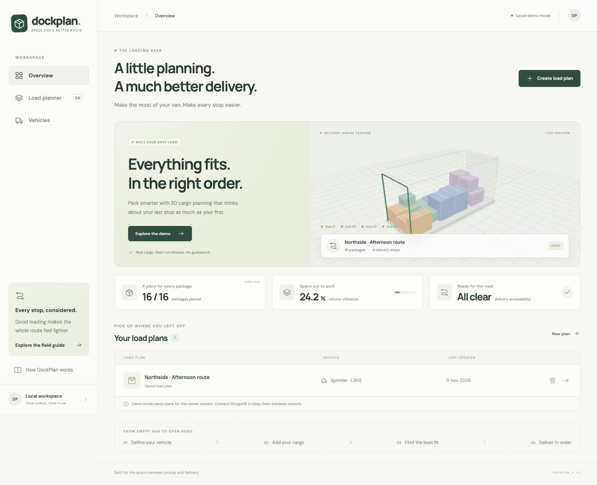
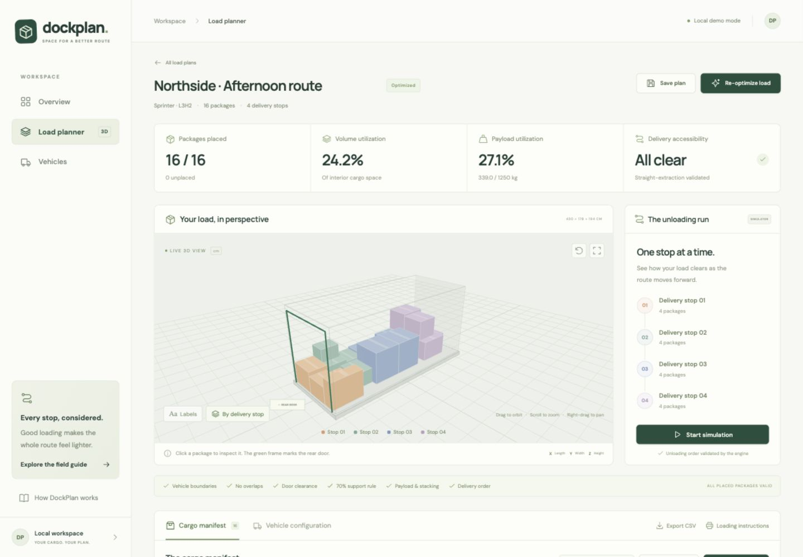

# DockPlan

**A little planning. A much better delivery.**

DockPlan plans an upright rectangular cargo load inside a delivery van, then checks that the boxes can be unloaded in delivery order. It is a working MERN portfolio project with a custom JavaScript packing heuristic, an interactive 3D view, and a server-validated unloading simulator.

Packing a van is not just a volume problem: putting the first delivery behind the last one wastes time. DockPlan combines geometric feasibility with a deliberately explicit straight-extraction model. It reports every package that could not be placed instead of silently dropping it.

## What works

- Vehicle dimensions, payload and rear-door configuration, plus reusable vehicle presets.
- Manual package entry, editing, removal, handling restrictions and delivery stops.
- CSV import with per-row validation, duplicate detection and a downloadable 16-package sample.
- Three deterministic extreme-point packing strategies; no packing service or API key.
- Boundary, AABB collision, payload, orientation, door corridor, 70% support, fragile/no-stack, stacking load and delivery-order checks.
- Actual optimizer positions in React Three Fiber: orbit, zoom, pan, selection, stop colors, labels, camera reset, expand and hide/show cargo.
- Server-generated unloading order, stop-by-stop animation, previous stop and reset.
- Google sign-in with private, account-scoped vehicle presets and saved load plans.
- Save/reopen/delete plans and persist their optimization result in MongoDB.
- Placement CSV export, including unplaced cargo and reasons; print-friendly loading instructions with browser Save as PDF.
- Responsive overview, planner, vehicles and field-guide screens; offline/API and WebGL error states.

## Screenshots

Captured from the running application using the actual demo optimizer output:




## Stack

React 19, Vite 7, JavaScript, Tailwind CSS 3, React Router, Three.js, React Three Fiber and Drei. The API uses Node.js, Express 4, Mongoose 8, MongoDB, Multer 2 and `csv-parse` 7. Tests use Node's built-in runner. Prettier formats the source. Lockfiles pin the installed dependency versions.

No paid services or API keys are required to explore the packing demo. Saving private plans requires a free Google OAuth web client and MongoDB; see [Google login and Vercel setup](docs/DEPLOYMENT.md). Google Fonts improve the typography when online; local sans-serif fallbacks keep the app usable offline.

## Start locally

Install **Node.js 22.12 or newer** and npm. From the repository root:

```sh
npm run setup
npm run dev
```

Open **http://localhost:5173**. Vite proxies `/api` to Express on port **4000**. Choose **Explore the demo** to run the real optimizer immediately. Both processes stay in the same terminal; Ctrl+C stops them.

With no MongoDB, the public optimizer still works. Production account storage is disabled until MongoDB and Google OAuth are configured. Local development can use temporary in-memory account storage, which resets on restart. A configured but unreachable MongoDB causes startup to fail clearly; it never silently falls back and loses saved data.

### Enable durable MongoDB storage

Use an existing local MongoDB instance or, if Docker is installed:

```sh
docker compose up -d
cp .env.example .env
npm run dev
```

The included Compose file runs MongoDB 8 on loopback port 27017 with a named data volume. `docker compose down` stops it and retains that volume. Restart the API after changing environment variables. The header will show **MongoDB connected**.

The API reads `server/.env` if present, otherwise the root `.env`. Shell environment variables are also supported. Keep both `.env` files out of Git.

| Variable                    | Default / purpose                                                                   |
| --------------------------- | ----------------------------------------------------------------------------------- |
| `PORT`                      | `4000`, Express port. If changed, update the Vite proxy in `client/vite.config.js`. |
| `MONGODB_URI`               | Unset means temporary demo storage. Example: `mongodb://127.0.0.1:27017/dockplan`.  |
| `CLIENT_ORIGIN`             | `http://localhost:5173`, allowed browser origin during development.                 |
| `DOCKPLAN_TEST_MONGODB_URI` | Optional dedicated database for the persistence integration test.                   |

### Production build, served by Express

```sh
npm run build
npm start
```

Open **http://localhost:4000**. Express serves the built client and its React Router routes, plus the API on the same origin. Build before starting. Development remains `npm run dev`.

## Google login and deployment

Follow [docs/DEPLOYMENT.md](docs/DEPLOYMENT.md) for Google OAuth, MongoDB Atlas, Vercel and callback URLs. The app never substitutes a demo identity for a Google account. Google configuration is reported honestly by the account controls and /api/auth/session.

## Use the sample CSV

Download **sample CSV** from the cargo manifest footer, or open `client/public/sample-packages.csv`. Importing appends valid records; invalid or duplicate rows are skipped and reported. Files are limited to 1 MB and plans to 100 packages.

Required columns: `id,label,length,width,height,weight,stop`.

Optional columns: `fragile,noStack,baseRotationAllowed,maxStackingLoadKg`. Booleans accept `true`/`false` or `1`/`0` (lowercase or uppercase words). Empty handling flags default to false; empty base rotation defaults to true. Empty stacking load means no weight limit. **Zero** stacking load forbids any load above the box. IDs must be unique. Stops are positive whole numbers; gaps in stop numbering are allowed. Dimensions are cm; weight and load limit are kg.

The demo has 16 packages, 4 stops and 339 kg of cargo. With the default van, the current heuristic places all 16 with 24.2% interior volume utilization and 27.1% payload utilization. These metrics are computed by the API, not hardcoded in the UI.

## Verification

```sh
npm test
npm run build
```

The suite covers packing constraints, deterministic results, all unloading prefixes, malformed input, CSV parsing/multipart upload, exports, API CRUD, optimization and simulation. The MongoDB test skips when no test URI is supplied. To include it against a **dedicated test database**:

```sh
DOCKPLAN_TEST_MONGODB_URI=mongodb://127.0.0.1:27017/dockplan_test npm test
```

The integration test creates its own vehicle/plan records, disconnects, reconnects, verifies the saved result, then removes its records. See `docs/VERIFICATION.md` for the checks performed during implementation.

## Project structure

```text
DockPlan/
├── client/
│   ├── public/               # Sample CSV and favicon
│   └── src/
│       ├── components/       # 3D viewer, forms, simulation and print modal
│       ├── data/demo.js      # Input data only; no predetermined placements
│       ├── pages/            # Overview, planner, vehicles and field guide
│       ├── services/api.js   # Fetch, errors and CSV download
│       ├── App.jsx           # Router and application shell
│       └── styles.css        # Tailwind entry point and visual styles
├── server/
│   ├── src/
│   │   ├── optimizer/        # Pure packing and geometry modules
│   │   ├── models/           # Mongoose schemas
│   │   ├── utils/            # Validation and CSV parsing/export
│   │   ├── app.js            # Express routes and error handling
│   │   ├── store.js          # MongoDB / memory repository
│   │   └── index.js          # Environment, connection and startup
│   └── test/                 # Node tests, including optional MongoDB test
├── docs/                     # Architecture, algorithm and learning guide
├── compose.yaml              # Optional local MongoDB
└── .env.example
```

## Deliberate limits

This is a feasible-placement heuristic, not a proof of optimal packing. It considers a restricted set of extreme points and never rearranges an already placed box within a strategy. A package may therefore be unplaced even when another arrangement exists.

Boxes stay upright and slide straight along −X. The rear door is centered across Y and begins at the floor. Cargo outside that opening's width/height corridor is intentionally not used, even if the wider interior has space. A box cannot be unloaded while supporting another box. Stacking-load checks conservatively assign the full weight of every descendant to each supporting base. These choices reject some practical loads but keep the model defensible.

No friction, center-of-mass stability, axle loads, load securing, arbitrary lifting/tilting, route routing, local search, physics or space-first comparison is implemented. The animation illustrates the validated order; it is not a physical handling simulation. PDF export uses the browser's print dialog. MongoDB is required for persistence between server restarts.

## Read these five files first

1. `server/src/optimizer/index.js` — strategy loop, feasibility gates, scoring and final audit.
2. `server/src/optimizer/geometry.js` — AABB geometry, support and unloading dependencies.
3. `server/src/app.js` — how HTTP input reaches validation, optimization and persistence.
4. `client/src/pages/Planner.jsx` — state, editing and the API-driven workflow.
5. `client/src/components/CargoViewer.jsx` — coordinate conversion and interactive 3D rendering.

Then follow [the learning guide](docs/LEARNING_GUIDE.md), [architecture](docs/ARCHITECTURE.md) and [algorithm explanation](docs/ALGORITHM.md).
