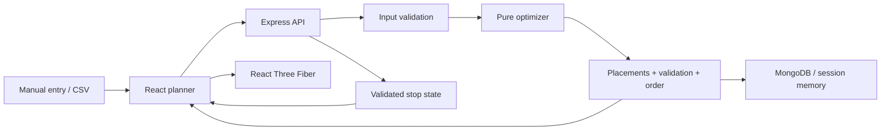

# DockPlan architecture

## Boundaries

The frontend manages user interaction, the Express API validates and computes, and MongoDB stores snapshots. The optimizer imports no Express, React, Mongoose, filesystem or network code. Its input and output are ordinary JavaScript objects. This makes the most important part easy to test without running the web app.

## Frontend

`main.jsx` mounts the router. `App.jsx` supplies the sidebar and routes: `/`, `/plans/new`, `/plans/demo`, `/plans/:id`, `/vehicles`, `/guide`.

`Dashboard.jsx` requests saved summaries and independently optimizes the demo input. It renders no fabricated plans or statistics. The demo file contains only the original vehicle and packages.

`Planner.jsx` owns editable plan state, current server result, package selection, hidden IDs and simulation state. Editing geometry or cargo clears the old result and simulation, so the viewer never represents old coordinates as the new plan. A request version prevents an optimization response from replacing newer edits. Save persists the input and asks the server to recompute an existing result rather than trusting a client-supplied placement.

Small components handle the vehicle form, package modal, unloading presentation and print instructions. `CargoViewer.jsx` lazy-loads the Three.js stack only when a view needs it. It renders the actual result, maps the application Z axis to Three's vertical Y axis, and animates API-provided unload IDs in sequence. `api.js` centralizes fetch error messages and CSV downloads.

Most styles are semantic CSS so a beginner can follow them alongside the JSX. Tailwind supplies the base layer and is available for utility changes. The interface uses a restrained green palette, custom SVG icons and responsive layouts. No UI framework or state-management dependency is needed.

## API contract

All JSON errors use `{ message, details: [] }`. Validation errors return 422, missing records 404, malformed JSON 400, and unexpected server errors a generic 500 message. Stack traces are never sent to the client. JSON and CSV bodies are limited to 1 MB; there are at most 100 packages per plan.

| Method     | Endpoint                       | Behavior                                                                                                                                                  |
| ---------- | ------------------------------ | --------------------------------------------------------------------------------------------------------------------------------------------------------- |
| GET        | `/api/health`                  | Health and `memory` or `mongodb` storage mode.                                                                                                            |
| GET / POST | `/api/vehicles`                | List / create a reusable vehicle preset.                                                                                                                  |
| GET / POST | `/api/load-plans`              | List summaries / save a new input snapshot; `optimize: true` computes and stores its result.                                                              |
| GET        | `/api/load-plans/:id`          | Return input and saved optimization result.                                                                                                               |
| PUT        | `/api/load-plans/:id`          | Replace validated input. Recompute result when `optimize: true`; otherwise clear the old result.                                                          |
| DELETE     | `/api/load-plans/:id`          | Delete the plan; return 204.                                                                                                                              |
| POST       | `/api/load-plans/:id/optimize` | Optimize the saved input, persist result, return it.                                                                                                      |
| POST       | `/api/optimize`                | Optimize an unsaved plan without creating a record.                                                                                                       |
| POST       | `/api/simulate`                | Accept plan plus `completedStopCount`, recompute deterministic result, return validated remaining/unloaded IDs, next stop, next order and first ready ID. |
| POST       | `/api/import/csv`              | Multipart `file`; return valid package records and errors with CSV row numbers.                                                                           |
| POST       | `/api/export/csv`              | Validate input and recompute placements; download placed and unplaced records.                                                                            |

The simulation endpoint is stateless. It runs the real server engine each time and accepts only a count into its sorted unique stops. The browser never determines geometry validity or invents a sequence. A single optimization can currently take around a couple of seconds at the 100-package cap; recomputation is a deliberate simplicity tradeoff. Caching by input hash or saving simulation sessions is an improvement for larger workloads.

Routes remain in one small module because the application has no separate business layer beyond the engine and repository. Splitting identical pass-through controllers would add indirection without helping this MVP. Extract route modules when it grows.

## Data models and persistence

`models/index.js` defines:

- **Vehicle**: name, length, width, height, payload, rear-door width/height, timestamps.
- **Package subdocument**: ID, label, dimensions, weight, stop, handling flags, optional stacking load.
- **Optimization result subdocument**: placements, unplaced reasons, metrics, support checks, final constraint audit, accessibility, unloading order, score and assumptions.
- **LoadPlan**: name, vehicle snapshot, embedded packages, optional result and timestamps.

A plan embeds its vehicle configuration so changing or selecting a preset cannot rewrite an old plan. Packages belong to a load plan, so embedding them avoids joins for this bounded workload. Package IDs are unique within each plan, not globally. Some result fields use Mongoose `Mixed` because they are generated by the trusted engine and evolve together; input fields are explicitly typed. API input validation still runs before Mongoose.

`store.js` exposes the same repository methods for MongoDB and a Map-backed demo store. MongoDB connections are established before the server starts accepting requests. An explicit URI that fails to connect stops startup. The Map mode is intentionally temporary and clearly identified in the UI. Tests inject a fresh store without connecting to a database.

## CSV data flow

1. A file goes to Multer memory storage with a size limit.
2. `csv-parse` handles quoting, BOM, headers and record structure.
3. Header checks reject missing required or duplicate columns. `parsePackage` validates every row; duplicate IDs are reported.
4. The API returns valid rows plus invalid row diagnostics. No records are saved automatically.
5. The UI appends valid rows, reports IDs already in the current manifest, and invalidates prior results.
6. Optimization validates the complete input again. The UI receives min-corner positions, oriented dimensions and rotations.
7. Three.js converts cm to scene units and reads exactly those values.

CSV export also recomputes on the server; it does not accept arbitrary placements. Instructions use the current engine result, with loading order equal to the reverse of unloading order.

## Running modes

During development Vite serves port 5173 and proxies `/api` to Express on 4000. In a production build Express serves `client/dist` and the SPA's non-API routes on port 4000. Vercel serves the static client and routes /api to api/index.js, which caches the Express app and MongoDB connection pool. Public optimization does not require an account. Saved plans and vehicles require Google login and every repository query is scoped to the verified Google subject. Production authentication requires durable MongoDB storage. See DEPLOYMENT.md for configuration.

## Google identity and sessions

The auth module implements the Google authorization-code flow using google-auth-library. A short-lived MongoDB OAuth record binds state to an HttpOnly browser cookie and stores PKCE verifier, nonce and a constrained local return path. Atomic consumption prevents callback replay. Google ID-token signature, issuer, audience and expiry are verified by the library; DockPlan additionally checks nonce and verified email. No provider access/refresh tokens are stored.

An opaque seven-day session token is stored only in an HttpOnly cookie (Secure on HTTPS, SameSite=Lax for the OAuth redirect). MongoDB stores its SHA-256 hash, expiry, identity and CSRF token. Mutating private routes require the session's CSRF header and reject a conflicting Origin. Logout deletes the server record. Session and flow TTL indexes remove expired records, and queries also enforce expiry before cleanup.

User records use Google's subject as their key; Vehicle presets and LoadPlans have an indexed ownerId. Embedded vehicle snapshots do not have an owner field. Unowned legacy records are intentionally not exposed. The auth context fetches session state once and private lists are only requested for a signed-in user.

Auth routes: GET /api/auth/session, GET /api/auth/google, GET /api/auth/google/callback, POST /api/auth/logout. Public compute/CSV/simulation remain available to guests. Rate limits are per process/function instance; Vercel firewall rules are recommended for sustained public abuse. The CSP permits inline styles for Three.js/React dynamic positioning, but does not permit inline scripts or eval.
